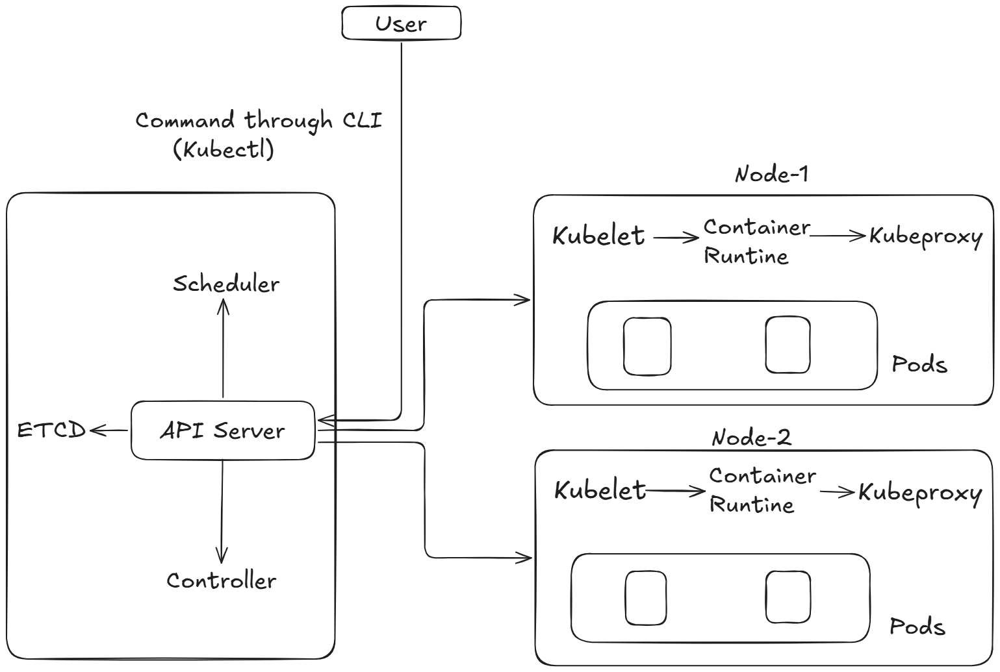

# Kubernetes Architecture: Components and Their Responsibilities

### 1. API Server (`kube-apiserver`)

The API Server is the **main entry point for communication with the Kubernetes cluster**.

When we run a command such as `kubectl apply -f deployment.yaml`, the request goes to the API Server. It validates the request, processes it, and coordinates access to the cluster's state through the Kubernetes API.

### 2. etcd

etcd is the **key-value data store** of Kubernetes. It stores the cluster's persistent state and configuration, including information about Pods, Deployments, Nodes, and other Kubernetes resources.

It doesn't store all the actual running containers or their files. Instead, it stores the data Kubernetes needs to track and manage its resources.

### 3. Scheduler (`kube-scheduler`)

The Scheduler decides **which worker node should run a newly created Pod that hasn't been assigned to a node yet**.
It considers factors such as resource availability, scheduling constraints, and placement policies.

For example, if a Deployment requests three Pod replicas, the Scheduler helps assign those Pods to suitable nodes.

### 4. Controller Manager (`kube-controller-manager`)

The Controller Manager runs controllers that continuously compare the actual cluster state with the desired state.

For example, if a Deployment requires three Pod replicas but one Pod fails, the relevant controllers work to create a replacement so Kubernetes can return to the desired number of replicas.
This is how Kubernetes provides much of its self-healing behavior.

### 5. Kubelet

Kubelet runs on each worker node and communicates with the API Server to learn which Pods should be running on its node. Kubelet manages the lifecycle of Pods on its node; it doesn't directly transfer a task into a Pod.

It works with the container runtime to ensure that the containers belonging to those Pods are running as required. It also reports node and Pod status back to the control plane.

### 6. Container Runtime

The Container Runtime is the software responsible for running containers on a node.

Kubelet communicates with the runtime through the Container Runtime Interface (CRI). The runtime handles tasks such as pulling container images and creating and running containers.

**Difference:** Kubelet manages Pods and coordinates their execution; the container runtime performs the lower-level container operations.

### 7. Kube-proxy

Kube-proxy handles network rules that enable Kubernetes Services to direct traffic to the appropriate Pods, when kube-proxy is used in the cluster.

For example, if a Service provides access to several application Pods, kube-proxy helps route network traffic to the available backends.

### 8. Pods

A Pod is the **smallest deployable unit in Kubernetes**. It contains one or more containers that share certain resources, such as network identity, and may share storage.

Most Pods contain one application container, although multi-container Pods are useful when containers need to work closely together.

### Working Flow 
kubectl → API Server → Controllers create Pods → Scheduler assigns nodes → Kubelet → Container Runtime → Running containers

### Summary

| API Server    Processes Kubernetes API requests |
| etcd          Stores the cluster's persistent state |
| Scheduler     Assigns unscheduled Pods to nodes |
| Controller    Reconciles actual state with desired state |
| Kubelet       Ensures Pods run on its node |
| Container     Pulls images and runs containers |
| Kube-proxy    Implements Service networking rules, when used |
| Pod           Smallest deployable unit in Kubernetes |