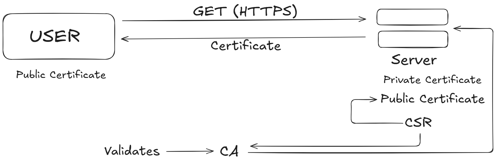

# SSL & TLS (Secure Communication and Hacker Attacks)

## 1. Introduction to SSL and TLS

SSL (Secure Sockets Layer) and TLS (Transport Layer Security) are cryptographic protocols used to secure communication between a client and a server.

For example, when a user opens a website using HTTPS, TLS helps protect the communication between the browser and the web server.

### Why do we need SSL/TLS?

Without encryption, an attacker who can intercept network traffic may be able to read sensitive information, such as login credentials or session cookies.

TLS provides three important security properties:

- **Confidentiality:** Prevents unauthorized parties from reading the data.
- **Integrity:** Helps detect whether data has been modified during transmission.
- **Authentication:** Helps the client verify that it is communicating with the intended server.

**Note:** SSL is obsolete and insecure. Modern HTTPS uses TLS, although people still commonly say "SSL certificate" when referring to a TLS certificate.

---

## 2. Understanding Asymmetric Encryption

### Objective

Understand how public and private keys are used to protect a symmetric encryption key during secure communication.

Asymmetric encryption uses a pair of mathematically related keys:

- **Public key:** Can be shared with others.
- **Private key:** Must remain secret and under the owner's control.

Data encrypted using a public key can, with suitable algorithms, be decrypted using the corresponding private key.

### Flow of Asymmetric Encryption

Suppose a client wants to establish secure communication with a server.

**Step 1: The server has a key pair**

The server owns a public key and a corresponding private key.

- The public key can be shared with the client.
- The private key remains on the server and must not be disclosed.

**Step 2: The client obtains the server's public key**

The server provides its public key to the client.

However, receiving a public key alone does not prove that it belongs to the genuine server. The client needs a way to verify the key's identity.

**Step 3: The client generates a symmetric key**

The client generates a random symmetric session key.

Symmetric encryption uses the same secret key to encrypt and decrypt data.

**Step 4: The client encrypts the symmetric key**

In a simplified public-key encryption flow, the client encrypts the symmetric key using the server's public key.

**Step 5: The client sends the encrypted key to the server**

An attacker intercepting the transmission cannot ordinarily recover the symmetric key without the corresponding private key.

**Step 6: The server decrypts the symmetric key**

The server uses its private key to recover the symmetric key.

Both sides can now use the shared symmetric key to encrypt and decrypt application data.

### Why use both encryption methods?

- Asymmetric cryptography helps establish trust or protect key establishment.
- Symmetric cryptography is generally much faster for encrypting large amounts of application data.

**Important:** This is a simplified hybrid-encryption model. Modern TLS commonly uses asymmetric cryptography for authentication and ephemeral Diffie–Hellman key exchange to derive shared session keys, rather than encrypting the session key directly with the server's public key.

---

## 3. Understanding Certificate-Based TLS Communication

### Objective

Understand how a digital certificate helps the client verify the server's identity before establishing a secure connection.
A public key alone does not establish whose key it is. A digital certificate connects a public key to an identity, such as a domain name, through a trusted certificate authority.

### Flow of Certificate-Based TLS



**Step 1: The client requests an HTTPS connection**

The client accesses a website using an HTTPS URL.

For example:

```text
https://example.com
```

The client and server begin the TLS handshake.

**Step 2: The server sends its digital certificate**

The server sends its certificate to the client. The certificate contains information such as:

- The domain names for which the certificate is valid.
- The server's public key.
- The certificate issuer.
- The validity period.
- The certificate authority's digital signature.

**Step 3: The client validates the certificate**

The client checks whether:

- The certificate is issued for the requested domain.
- The certificate is within its validity period.
- The certificate chain leads to a trusted certificate authority.
- The certificate signatures and other relevant constraints are valid.

If validation fails, the client should warn the user or terminate the connection, depending on the failure and application policy.

**Step 4: The client and server establish session keys**

In modern TLS, the client and server typically perform an ephemeral key exchange, such as ECDHE, to derive shared session keys.

The server also proves possession of the private key associated with its certificate, typically through a handshake signature.

The certificate's public key is not normally used to encrypt the symmetric session key directly in modern TLS.

**Step 5: Encrypted communication begins**

After the handshake completes successfully, the client and server use the derived symmetric keys to protect application data.

For HTTPS, this includes HTTP requests and responses.

The communication is now protected by TLS, assuming the cryptographic negotiation and certificate validation succeeded.

---

## 4. How Does a Certificate Authority Issue a Certificate?

A Certificate Authority (CA) is an entity trusted to issue and sign digital certificates.

The certificate issuance process generally works as follows:

**Step 1: Generate a key pair**

The server operator generates a public key and private key. The private key must remain secret.

**Step 2: Create a Certificate Signing Request (CSR)**

The operator creates a CSR containing the public key and the requested identity information, such as the domain name.

**Step 3: Submit the CSR to the CA**

The CA verifies that the requester is authorized to obtain a certificate for the requested domain or identity.

**Step 4: The CA issues the certificate**

After successful validation, the CA signs the certificate with its signing key.

The signed certificate binds the verified identity to the public key.

**Step 5: Configure the server**

The server administrator installs the certificate and configures the server to use the corresponding private key.

**Step 6: The client validates the certificate**

When a browser connects, it validates the certificate chain and the domain name before trusting the server's identity.

**Remember:** The certificate contains the public key, not the server's private key. The private key must never be sent to the client or included in the certificate.

---

## 5. Hacker Attack: Man-in-the-Middle (MITM)

A Man-in-the-Middle (MITM) attack occurs when an attacker positions themselves between two communicating parties and attempts to intercept, read, or alter their traffic.

### Scenario: Communication Without Proper Authentication

Suppose a user connects to a server, but the user does not verify that the received public key belongs to the genuine server.

The attacker can exploit this missing verification.

**Step 1: The user attempts to connect to the server**

The user wants to establish a secure connection to the legitimate website.

**Step 2: The attacker intercepts the connection**

The attacker positions themselves between the user and the server, potentially using a compromised network or malicious access point.

**Step 3: The attacker presents their own public key**

If the client accepts an unverified public key, the attacker can pretend to be the legitimate server.

**Step 4: Two separate encrypted connections are established**

The attacker may establish one encrypted connection with the user and another with the real server.

The attacker can decrypt and re-encrypt data passing between those connections.

**Step 5: Sensitive information may be exposed**

If the attack succeeds, the attacker may be able to read or modify information such as login credentials, messages, or other application data.

### How TLS Prevents This Attack

TLS helps prevent MITM attacks by combining certificate validation, proof of possession of the server's private key, authenticated key establishment, and integrity protection.

- The client validates the server certificate and its domain name.
- The server proves possession of the corresponding private key during the handshake.
- The handshake establishes shared session keys.
- Authenticated encryption protects application data against unauthorized reading and modification.

If an attacker substitutes their own certificate, the client should reject it unless the attacker can satisfy the relevant trust and validation requirements.

**Important:** Encryption alone is not enough. If a client accepts an attacker's public key without verifying the server's identity, encrypted communication can still be intercepted.

---

## 6. Other Ways an Attacker May Try to Compromise TLS

### 6.1 Fake or untrusted certificates

An attacker may attempt to present a self-signed certificate or a certificate for the wrong domain.

**Protection:** Validate the certificate chain, domain name, validity period, and other applicable certificate requirements.

### 6.2 Compromised private key

If an attacker steals the server's private key, they may be able to impersonate the server in certain circumstances.

For modern TLS with ephemeral key exchange, stealing the certificate's private key alone does not normally allow an attacker to decrypt previously recorded sessions.

**Protection:** Store private keys securely, restrict access, rotate compromised keys, and use modern TLS configurations.

### 6.3 Downgrade attacks

An attacker may try to interfere with negotiation so that the parties use weaker protocol versions or cryptographic settings.

**Protection:** Disable obsolete protocols and weak cipher suites, and use modern TLS configurations with downgrade protections.

### 6.4 Compromised client or server

TLS protects data in transit, but it cannot guarantee that an endpoint is safe. Malware or unauthorized access on a user's computer or the server may expose information before encryption or after decryption.

**Protection:** Keep systems updated, secure credentials, use endpoint protection, and apply least-privilege access controls.

---

## 7. SSL vs. TLS

| Feature   | SSL                           | TLS                                               |
|-----------|-------------------------------|---------------------------------------------------|
| Full form | Secure Sockets Layer          | Transport Layer Security                          |
| Status    | Obsolete and insecure         | Modern standard                                   |
| Security  | Vulnerable to known attacks   | Stronger, depending on version and configuration  |
| Use today | Should not be enabled         | Used to secure HTTPS and other network protocols  |
| versions  | None                          | TLS 1.2 or TLS 1.3                                |


---

## 8. Key Learnings

1. Asymmetric cryptography uses public and private keys.
2. Symmetric cryptography uses a shared secret key and is efficient for application data.
3. A digital certificate binds an identity to a public key.
4. A Certificate Authority signs certificates after performing the relevant identity validation.
5. Modern TLS uses certificate-based authentication and key exchange to establish session keys.
6. A MITM attack can succeed when a client fails to verify the identity of the party it is communicating with.
7. Certificate validation and authenticated encryption are both essential to secure communication.
8. SSL is obsolete; modern secure communication should use TLS.